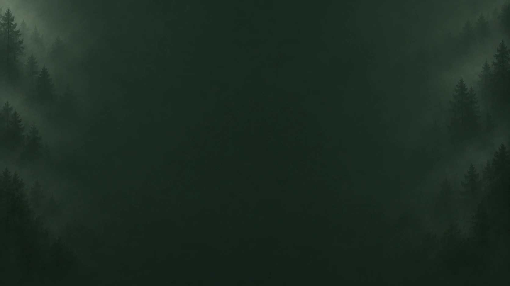

# NovelStory 배경 이미지

[NovelStory Studio](https://novelstory-studio.com)의 원고 배경으로 쓸 수 있는 **407개의 WebP 이미지**입니다.
원고 주변을 차분하게 비우고 가장자리의 작은 소재와 색감을 다양하게 구성했습니다.
모든 이미지는 **1672×941픽셀**이며, 원하는 테마만 ZIP으로 받을 수 있습니다.

## 다운로드

- **[전체 407종 받기 · 12.12 MiB](https://github.com/HoneyOfOneDayButterfly/novelstory-background/raw/main/downloads/novelstory-background-all.zip)** — 전체 이미지와 오프라인 미리보기 포함
- [ZIP 파일 SHA-256 목록](https://github.com/HoneyOfOneDayButterfly/novelstory-background/raw/main/downloads/SHA256SUMS.txt)

아래 표의 **ZIP 받기**를 누르면 해당 테마의 이미지 파일만 다운로드합니다.
개별 파일이 필요하면 **폴더 보기**에서 이미지를 열고 원본 파일을 저장하세요.

## 앱 테마에 어울리는 배경 · 11개 묶음

| 미리보기 | 테마 | 이미지 수 | ZIP | 개별 파일 |
|---|---|---:|---|---|
|  | 밤 | 29종 | [ZIP 받기 · 936 KiB](https://github.com/HoneyOfOneDayButterfly/novelstory-background/raw/main/downloads/novelstory-background-dark.zip) | [폴더 보기](backgrounds/dark/) |
|  | 먹 | 27종 | [ZIP 받기 · 953 KiB](https://github.com/HoneyOfOneDayButterfly/novelstory-background/raw/main/downloads/novelstory-background-ink.zip) | [폴더 보기](backgrounds/ink/) |
|  | 숲 | 26종 | [ZIP 받기 · 720 KiB](https://github.com/HoneyOfOneDayButterfly/novelstory-background/raw/main/downloads/novelstory-background-forest.zip) | [폴더 보기](backgrounds/forest/) |
|  | 메탈 | 25종 | [ZIP 받기 · 976 KiB](https://github.com/HoneyOfOneDayButterfly/novelstory-background/raw/main/downloads/novelstory-background-metal.zip) | [폴더 보기](backgrounds/metal/) |
|  | 사이버펑크 | 27종 | [ZIP 받기 · 679 KiB](https://github.com/HoneyOfOneDayButterfly/novelstory-background/raw/main/downloads/novelstory-background-cyberpunk.zip) | [폴더 보기](backgrounds/cyberpunk/) |
|  | 낮 | 28종 | [ZIP 받기 · 882 KiB](https://github.com/HoneyOfOneDayButterfly/novelstory-background/raw/main/downloads/novelstory-background-light.zip) | [폴더 보기](backgrounds/light/) |
|  | 세피아 | 29종 | [ZIP 받기 · 992 KiB](https://github.com/HoneyOfOneDayButterfly/novelstory-background/raw/main/downloads/novelstory-background-sepia.zip) | [폴더 보기](backgrounds/sepia/) |
|  | 새벽 | 24종 | [ZIP 받기 · 598 KiB](https://github.com/HoneyOfOneDayButterfly/novelstory-background/raw/main/downloads/novelstory-background-dawn.zip) | [폴더 보기](backgrounds/dawn/) |
|  | 화이트 | 26종 | [ZIP 받기 · 596 KiB](https://github.com/HoneyOfOneDayButterfly/novelstory-background/raw/main/downloads/novelstory-background-white.zip) | [폴더 보기](backgrounds/white/) |
|  | 크리스탈 | 25종 | [ZIP 받기 · 594 KiB](https://github.com/HoneyOfOneDayButterfly/novelstory-background/raw/main/downloads/novelstory-background-crystal.zip) | [폴더 보기](backgrounds/crystal/) |
|  | 벚꽃 | 26종 | [ZIP 받기 · 686 KiB](https://github.com/HoneyOfOneDayButterfly/novelstory-background/raw/main/downloads/novelstory-background-sakura.zip) | [폴더 보기](backgrounds/sakura/) |

## 별도 색감의 배경 · 5개 묶음

| 미리보기 | 테마 | 이미지 수 | ZIP | 개별 파일 |
|---|---|---:|---|---|
|  | 따뜻한 다크 | 26종 | [ZIP 받기 · 1.11 MiB](https://github.com/HoneyOfOneDayButterfly/novelstory-background/raw/main/downloads/novelstory-background-warm-dark.zip) | [폴더 보기](backgrounds/warm-dark/) |
|  | 그린 라이트 | 23종 | [ZIP 받기 · 720 KiB](https://github.com/HoneyOfOneDayButterfly/novelstory-background/raw/main/downloads/novelstory-background-green-light.zip) | [폴더 보기](backgrounds/green-light/) |
|  | 파스텔 라이트 | 23종 | [ZIP 받기 · 645 KiB](https://github.com/HoneyOfOneDayButterfly/novelstory-background/raw/main/downloads/novelstory-background-pastel-light.zip) | [폴더 보기](backgrounds/pastel-light/) |
|  | 청록 다크 | 22종 | [ZIP 받기 · 767 KiB](https://github.com/HoneyOfOneDayButterfly/novelstory-background/raw/main/downloads/novelstory-background-teal-dark.zip) | [폴더 보기](backgrounds/teal-dark/) |
|  | 자주 다크 | 21종 | [ZIP 받기 · 537 KiB](https://github.com/HoneyOfOneDayButterfly/novelstory-background/raw/main/downloads/novelstory-background-plum-dark.zip) | [폴더 보기](backgrounds/plum-dark/) |

## 사용 방법

1. 원하는 테마의 ZIP을 받고 압축을 풉니다.
2. `backgrounds/<테마 ID>/` 안에서 원하는 WebP 이미지를 고릅니다.
3. 이미지 배경을 지원하는 프로그램에서 사용합니다. 밝은 배경에는 짙은 글씨, 어두운 배경에는 밝은 글씨를 조합하세요.

전체 ZIP을 받았다면 `index.html`을 브라우저로 열어 폴더·소재·밝기별로 미리 볼 수 있습니다.
예시 문장을 얹어 보는 기능도 있으며, 문장은 실제 이미지에 들어 있지 않습니다.

NovelStory Studio에서는 사용자 테마 팩의 집필 배경 이미지로 사용할 수 있습니다.
이 다운로드는 이미지 파일 모음이며 앱에 테마를 자동 설치하거나 현재 테마를 바꾸지 않습니다.

## 파일 정보

- 앱 테마에 어울리는 배경 292종과 별도 색감 배경 115종으로 구성했습니다.
- 테마 이름은 색감과 밝기를 기준으로 한 추천 분류입니다.
- 검증된 기존 WebP를 크기 변경이나 추가 변환 없이 그대로 담았습니다.
- AI로 생성한 이미지입니다. 자세한 생성 경위는 [SOURCES.md](SOURCES.md)를 참고하세요.
- [이미지 목록과 해시](catalog.json) · [이미지 SHA-256 목록](SHA256SUMS.txt) · [다운로드 파일 정보](downloads.json)

## 문의

다운로드 오류나 잘못 분류된 이미지가 있으면 [Issues](https://github.com/HoneyOfOneDayButterfly/novelstory-background/issues)에 알려 주세요.
